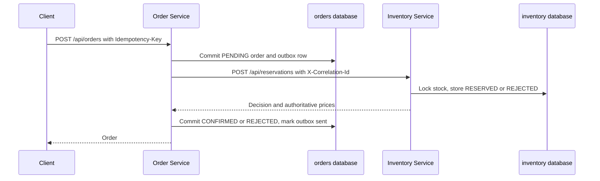
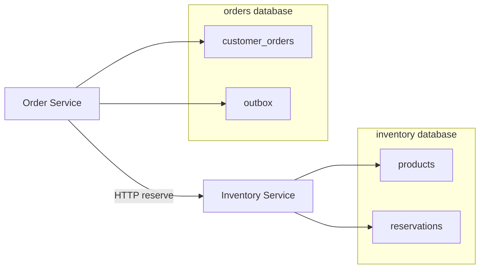

# VIDO POS order and inventory assessment

Two Spring Boot services share one PostgreSQL instance and keep separate databases. The order service never reads the inventory tables. It asks the inventory service to reserve stock, stores the prices that come back, and retries that request until the order is confirmed or rejected.

## Start the system

Requirements: JDK 21 or newer, Docker with Compose, and Maven 3.9+ (or the Maven Wrapper).

```powershell
docker compose up --build -d
docker compose ps
```

| Service | URL |
| --- | --- |
| Order Service | http://localhost:8080 |
| Inventory Service | http://localhost:8081 |
| Postgres | localhost:5432, database `orders` or `inventory`, user `vido`, password `vido` |

The database password is only for this local compose file. Do not reuse it anywhere else.

Wait until both health checks are up:

```powershell
curl.exe -fsS http://localhost:8081/actuator/health
curl.exe -fsS http://localhost:8080/actuator/health
```

Reset all data:

```powershell
docker compose down -v
```

### Example order

```powershell
$product = curl.exe -s -X POST http://localhost:8081/api/products `
  -H "Content-Type: application/json" `
  -d '{"name":"USB cable","price":9.50,"availableQuantity":5}' | ConvertFrom-Json

curl.exe -s -D - -X POST http://localhost:8080/api/orders `
  -H "Content-Type: application/json" `
  -H "Idempotency-Key: order-demo-001" `
  -H "X-Correlation-Id: demo-correlation-001" `
  -d "{`"customerEmail`":`"buyer@example.com`",`"items`":[{`"productId`":`"$($product.id)`",`"quantity`":2}]}"
```

A resolved create returns **201**. The body includes the items, the purchase price captured from inventory (`9.50`, not a client-supplied price), `total` of `19.00`, and `status` `CONFIRMED`. Repeating that command returns **200** and the same order id. The same key with a different quantity returns **409**.

`requests/api.http` has the same calls for an editor REST client. Replace `{{productId}}` and `{{orderId}}`.

Run one service on the host only when Postgres from Compose is already published on port 5432:

```powershell
mvn -pl inventory-service spring-boot:run
mvn -pl order-service spring-boot:run
```

## Run the tests

The tests do not need Docker. They start an embedded PostgreSQL 14 binary, so row locks, `SKIP LOCKED`, and advisory locks are real. JDK 21+ is enough.

```powershell
mvn test
```

On Windows PowerShell, if `java` is older than 21, point `JAVA_HOME` at a JDK 21+ install first. This workspace was verified with JDK 23, compiling with `--release 21`.

## Architecture



If the call to inventory times out, inventory returns 5xx, or the order process stops before the second database commit, the outbox row stays due. A relay retries it. Inventory answers with the decision it already stored, so stock does not move again.



There is no message broker. The outbox is still the recovery log: the order and the intent to reserve are committed together, and the HTTP send happens after that commit. A broker publisher would read the same table. The dual-write failure, where the database commit succeeds and the side effect never happens, is the case the relay exists for.

## API

Validation errors return 400 with `message`, `details`, and `correlationId`. Unknown JSON fields are rejected, including a client `price` on an order line.

### Inventory Service

`POST /api/products` creates a product with `name`, `price`, and `availableQuantity`.

`GET /api/products/{id}` reads it.

`PATCH /api/products/{id}/price` changes the current price. It does not change a reservation already stored.

`POST /api/reservations` accepts `orderId` and `items` of `productId` plus `quantity`. The response status is `RESERVED` or `REJECTED`. A business rejection is still HTTP 200: the service made a decision. HTTP 5xx and timeouts mean it did not.

`GET /api/reservations/{orderId}` returns that stored decision.

### Order Service

`POST /api/orders` requires `Idempotency-Key` (8 to 128 letters, digits, `.`, `_`, `:`, `-`). The body is `customerEmail` and `items` of `productId` plus `quantity`. Send `X-Correlation-Id` or the service generates one. That id is stored on the order, returned on later reads, forwarded to inventory, and printed in both services' logs.

| Result | HTTP | Order status |
| --- | --- | --- |
| Inventory decided on this new request | 201 | `CONFIRMED` or `REJECTED` |
| Inventory could not be reached | 202 | `PENDING` |
| Same key and same email, products, and quantities | 200 | the existing order, which may have moved forward |
| Same key and different content | 409 | unchanged |

`GET /api/orders/{id}` returns items, purchase `unitPrice`, `lineTotal`, `total`, and `status`. `total` is present only after confirmation. Email comparison ignores case, and item order does not matter for the idempotency hash.

Health for both services is `GET /actuator/health`, plus `/actuator/health/liveness` and `/actuator/health/readiness`.

## Data ownership

Inventory owns products, the current price, available quantity, and reservation decisions. An order id is unique in `reservations`. The decision row is written in the same transaction as the stock change, and it is not revised later. A rejected reservation stays rejected even if stock is added afterwards.

Orders own the customer email, line quantities, the purchase prices copied from the reservation, the total, the status, and the idempotency record. The order request has no price field.

## Idempotency

The order key is hashed with SHA-256 over the normalised email and the product/quantity lines sorted by product id. The hash is stored with a unique key. A replay returns the stored order. A different hash for the same key is a conflict and does not call inventory.

The reservation command is idempotent on the order id, which is a different key. A repeated HTTP call or a replayed outbox row hits `pg_advisory_xact_lock` for that order, then returns the stored decision. The unique constraint `uq_reservations_order_id` is the backstop if two transactions pass the lock. Stock is changed only in the transaction that inserts the decision.

## Concurrency

For a new reservation the inventory transaction locks product rows with `SELECT ... ORDER BY id FOR UPDATE`. Locking in id order is what keeps two orders that mention the same products from deadlocking when their request arrays are in opposite orders. The quantity check and the decrement happen while those locks are held. `available_quantity >= 0` is also a database check. Two orders that both want the last unit end with one `RESERVED` and one `REJECTED`.

## Recovery

An order is inserted as `PENDING` together with an outbox row, and that transaction commits before inventory is called. Confirmation is a second transaction, after a `RESERVED` or `REJECTED` response.

The relay claims a due outbox row with `FOR UPDATE SKIP LOCKED`, sets it to `PROCESSING`, and gives itself a 30 second lease. The HTTP call uses a 500ms connect timeout and a 2 second read timeout, and it is not inside a database transaction. One attempt is made per claim. If inventory cannot be reached, the row goes back to `PENDING` with `next_attempt_at` set by exponential backoff: 2s, 4s, 8s, 16s, then 30s. The order stays `PENDING`. It is not rejected merely because inventory is down, and it is not confirmed without a stored `RESERVED` decision.

A client that repeats the same idempotency key tries again immediately, without waiting for the backoff, unless another worker still holds an unexpired processing lease. The scheduled relay polls every 2 seconds and will also finish the order after a restart. A real crash that dies during `PROCESSING` waits until the lease expires, then the next poll takes the row.

An inventory HTTP 4xx is treated as a permanent rejection so a bad payload does not retry forever. Timeouts, connection failures, and HTTP 408, 429, and 5xx are retried.

### Guarantees

- A reservation either takes every requested line or none.
- At most one competing order gets the last unit.
- Each order id changes stock at most once.
- `CONFIRMED` is written only after inventory has a stored `RESERVED` decision.
- A `PENDING` order is finished once inventory stays reachable. The final status matches the stored decision.
- Repeating an idempotency key does not create a second order. Repeating the reserve call does not create a second reservation.

### Assumptions

- The order id is the reservation identity. The idempotency key is the client-request identity.
- PostgreSQL enforces the unique keys, row locks, and check constraints.
- Service clocks are close enough for backoff. Correctness does not depend on a shared clock. The claim and the processing lease use the database clock.
- There is one inventory authority. This version has no cancel or release API.
- A stored reservation decision is immutable.

### Limitations

- `PENDING` is a real state. Clients that receive 202 need to read the order again or send the same request again.
- Recovery waits for the backoff and, after a hard crash, for the remainder of the 30 second lease. It is not instantaneous.
- Idempotency keys and reservation decisions are kept indefinitely.
- A rejected line is not retried when stock is replenished later.
- A bug that makes inventory return a `RESERVED` body that does not match the order lines leaves the order `PENDING` and keeps retrying. It does not confirm a mismatched order.
- Both databases share one Postgres server in Compose, so they do not fail independently of that server. They still cannot read each other.
- There is no authentication, cancellation, tracing backend, or API gateway. Correlation ids are propagated on the HTTP calls and written to the logs.

## Reproduce the failure scenarios

Start the stack first with `docker compose up --build -d`. The scripts live in `scripts/` and throw if the expected outcome does not happen.

| Scenario | What happens | How to run it |
| --- | --- | --- |
| Two orders want the last unit | One `CONFIRMED`, the others `REJECTED`, stock 0 | `powershell -File scripts/race-last-unit.ps1` |
| One line is out of stock | The order is `REJECTED` and neither line is reserved | Create two products, give the second quantity 0, and order both. The automated test covers this directly. |
| Inventory is down | The order stays `PENDING`. After inventory returns, the same key confirms it and stock drops once | `powershell -File scripts/inventory-down.ps1` |
| Reservation is stored but the response is lost | Stock is already reduced while the order is `PENDING`. The retry confirms it and does not reduce stock again | `powershell -File scripts/lost-response.ps1` |
| Order process stops after the reservation and before confirmation | Stock is reserved, the order is `PENDING`, and a restart without the failure flag confirms it | `powershell -File scripts/crash-window.ps1` |
| The same request or reserve command is delivered twice | One order row, one reservation, one stock movement | Repeat `Idempotency-Key: order-demo-001`, or rerun either recovery script |

The lost-response demo sets `APP_DEMO_RESERVE_DELAY=5s` on inventory. The reservation transaction commits, and only then does the response wait. The order service stops reading after 2 seconds. `docker-compose.lost-response.yml` turns that delay on.

The crash demo sets `APP_DEMO_FAIL_BEFORE_STATUS_UPDATE=true` on the order service. Inventory has already committed. The order service throws before its confirmation transaction. `docker-compose.crash-window.yml` turns the flag on. Leave both flags off for normal use. They exist so the window is repeatable; they are not part of the recovery mechanism.

Useful checks:

```powershell
docker exec vido-postgres psql -U vido -d inventory -c "select available_quantity from products;"
docker exec vido-postgres psql -U vido -d inventory -c "select order_id, status from reservations;"
docker exec vido-postgres psql -U vido -d orders -c "select id, status, total from customer_orders;"
docker exec vido-postgres psql -U vido -d orders -c "select order_id, status, attempt_count, last_error from outbox;"
```

Logs include the correlation id in brackets. The same value is on the order response header and on the inventory request.

## Tests and where the rules live

| Rule | Test |
| --- | --- |
| Invalid product input, health | `InventoryApiTest` |
| Authoritative price kept after a later price change | `InventoryApiTest` |
| One short line rejects the whole reservation and moves no stock | `InventoryApiTest` |
| Unknown product reserves nothing | `InventoryApiTest` |
| Second reserve does not move stock | `InventoryApiTest` |
| Decision is committed before a held response, and the retry is safe | `InventoryApiTest` |
| Twelve orders, one unit | `InventoryConcurrencyTest` |
| Eight deliveries of one order id | `InventoryConcurrencyTest` |
| Opposite item order does not deadlock | `InventoryConcurrencyTest` |
| Confirmed order stores inventory prices, correlation id is forwarded | `OrderApiTest` |
| Missing key, bad email, client price, duplicate product | `OrderApiTest` |
| Idempotency replay and conflict | `OrderApiTest` |
| Inventory rejection | `OrderApiTest` |
| Inventory unavailable, then the same key recovers | `OrderApiTest` |
| Timed-out reserve, then retry confirms once | `OrderApiTest` |
| Failure after reserve, relay confirms once | `OrderApiTest` |
| Relay poll recovers a due outbox row | `OrderApiTest` |
| Eight concurrent posts of one key | `OrderApiTest` |
| Hash and backoff | `OrderRulesTest` |

The stock effects are asserted against inventory's database. The order tests call a local OkHttp server so they can return 503, delay the response past the client timeout, and reject a reservation without pretending that an in-memory mock changed stock.

Places to change during a walkthrough:

- `ReservationTransaction` decides stock, locks, and the stored decision.
- `OrderSubmissionService` and `RequestHasher` own the idempotency key.
- `OutboxRelay`, `OutboxClaimer`, and `OrderCompleter` own recovery and when an order becomes `CONFIRMED` or `REJECTED`.
- `InventoryClient` owns the timeouts.

## Tradeoffs

HTTP plus an outbox is enough for two services and keeps the failure path visible. A broker would add an operational component without a stronger business guarantee, as long as the consumer is idempotent, which the reservation endpoint is.

The happy path is synchronous: when inventory answers in time, the create call returns `CONFIRMED` or `REJECTED`. The asynchronous path exists for the outage and crash windows, which is why `PENDING` is part of the API.

Reservations are hard allocations. Available quantity falls when the reservation commits. There is no separate reserved counter and no release flow, because the brief does not ask for cancellation.

Business rejections are stored. That stops a duplicate delivery from succeeding later just because stock was refilled. The cost is that a rejected order does not heal itself.

## Time and AI assistance

This was implemented with Cursor's coding agent (Grok). I used it to draft the two services, the tests, and this write-up. The behaviour above was checked by reading `ReservationTransaction`, `OutboxRelay`, and `OrderSubmissionService`, and by running `mvn test`. The Docker failure scripts are the manual versions of those tests. They were not executed here because Docker is not installed on the machine used for the implementation; the automated tests cover the same outcomes against real PostgreSQL and a real HTTP timeout.

Scope was kept to the brief. Approximate effort was one focused implementation and review session rather than extra infrastructure.
